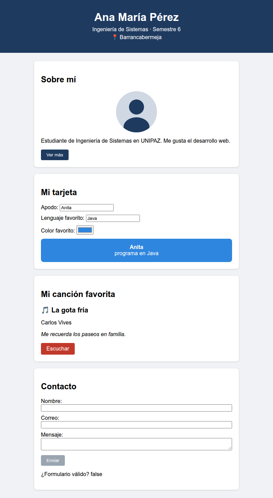
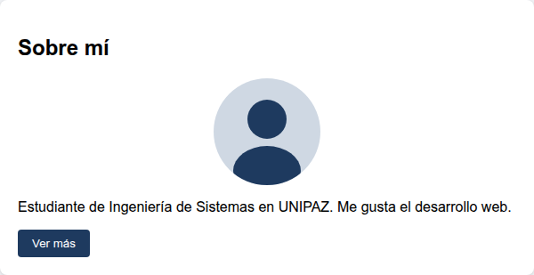
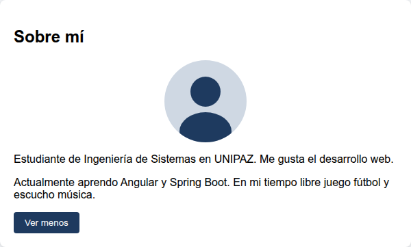
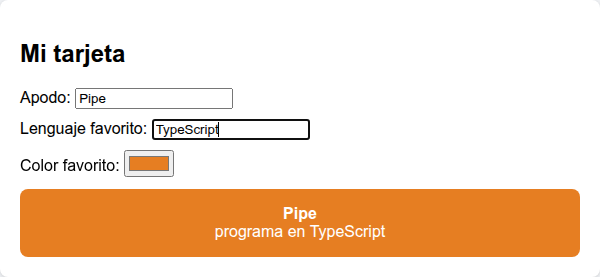
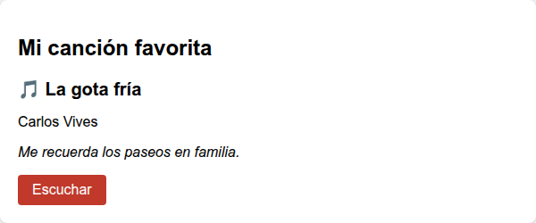
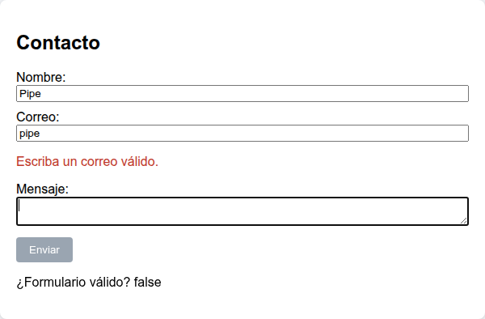
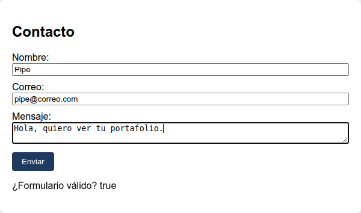
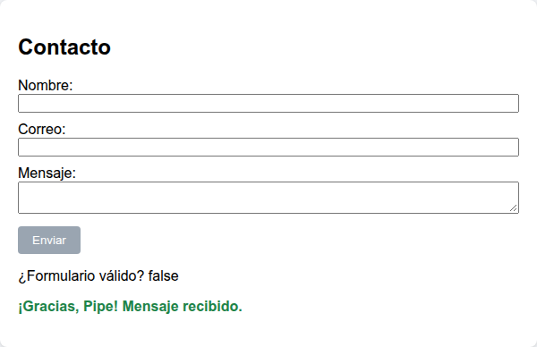

# Parcial PBC · N1 — Portafolio personal en Angular 21

**UNIPAZ · Ingeniería Informática · Escuela de Ciencias**
Programación Basada en Componentes · Grupo N1 · 2026B

Construcción de una **SPA (Single Page Application)** de presentación personal con **Angular 21**, desde la instalación de las herramientas hasta la entrega por *pull request*.

El proyecto cubre estos temas:

| Tema | Dónde se aplica |
|---|---|
| Interpolación `{{ }}` | Componente `encabezado` |
| Property binding `[ ]` y event binding `( )` | Componente `sobre-mi` |
| Two-way binding `[(ngModel)]` | Componente `editar-perfil` |
| Interpolación y property binding sobre un enlace `[href]` | Componente `cancion-favorita` |
| Formulario con `ngForm` y validaciones | Componente `contacto` |

---

## Resultado mínimo esperado

La aplicación terminada debe tener, **como mínimo**, lo que muestra esta imagen: los cinco bloques y su funcionamiento. Todo ocurre en una sola página y el navegador no la recarga en ningún momento. Se admite mejorar el diseño o agregar contenido, siempre que se conserve lo mínimo.



---

## Contenido

0. [Preparación del repositorio](#0-preparación-del-repositorio)
1. [Instalación de herramientas](#1-instalación-de-herramientas)
2. [Instalación de dependencias y ejecución](#2-instalación-de-dependencias-y-ejecución)
3. [Estructura de un proyecto Angular 21](#3-estructura-de-un-proyecto-angular-21)
4. [Limpieza de la página inicial y estilos globales](#4-limpieza-de-la-página-inicial-y-estilos-globales)
5. [Generación de componentes](#5-generación-de-componentes)
6. [Componente `encabezado`: interpolación](#6-componente-encabezado-interpolación)
7. [Componente `sobre-mi`: property binding y event binding](#7-componente-sobre-mi-property-binding-y-event-binding)
8. [Componente `editar-perfil`: two-way binding](#8-componente-editar-perfil-two-way-binding)
9. [Componente `cancion-favorita`: enlace con property binding](#9-componente-cancion-favorita-enlace-con-property-binding)
10. [Componente `contacto`: formulario con `ngForm`](#10-componente-contacto-formulario-con-ngform)
11. [Ensamble de la página en `app`](#11-ensamble-de-la-página-en-app)
12. [Personalización obligatoria](#12-personalización-obligatoria)
13. [Entrega por pull request](#13-entrega-por-pull-request)
14. [Lista de verificación](#14-lista-de-verificación)
15. [Problemas frecuentes](#15-problemas-frecuentes)

---

## 0. Preparación del repositorio

La entrega se hace sobre una copia propia (*fork*) de este repositorio, en una rama con el nombre del estudiante.

**0.1 — Fork.** En la parte superior derecha de esta página, botón **Fork** → **Create fork**. Queda una copia en la cuenta del estudiante: `https://github.com/<usuario>/parcial-pbc-n1`.

**0.2 — Clonar el fork** (el del estudiante, no el original):

```bash
git clone https://github.com/<usuario>/parcial-pbc-n1.git
cd parcial-pbc-n1
```

**0.3 — Crear la rama de trabajo.** El nombre de la rama es **nombre y apellido, en minúscula, sin tildes, sin espacios y sin ñ**. Ejemplo para *Ana María Pérez*: `anaperez`.

```bash
git checkout -b anaperez
```

Verificación: `git branch` muestra un asterisco junto a la rama nueva.

```
  main
* anaperez
```

> ⚠️ Todo el trabajo se hace en esa rama. Nada se sube a `main`.

---

## 1. Instalación de herramientas

### 1.1 Node.js

Angular 21 requiere **Node.js 20.19 o superior, 22.12 o superior, o 24 en adelante**. La versión recomendada es la **LTS** publicada en <https://nodejs.org>.

Verificación:

```bash
node -v
npm -v
```

Salida esperada (los números pueden variar):

```
v24.x.x
11.x.x
```

### 1.2 Angular CLI 21

El CLI (*Command Line Interface*) es la herramienta que genera componentes y ejecuta el servidor de desarrollo. Se instala de forma global y **fijando la versión 21**:

```bash
npm install -g @angular/cli@21
```

Verificación:

```bash
ng version
```

La salida debe incluir una línea como esta:

```
Angular CLI       : 21.2.x
```

> En Windows, si PowerShell responde *«la ejecución de scripts está deshabilitada en este sistema»*, ver la sección [Problemas frecuentes](#15-problemas-frecuentes).

---

## 2. Instalación de dependencias y ejecución

Este repositorio **ya es un proyecto Angular 21 base**, sin modificar. Se generó con el comando:

```bash
ng new parcial-pbc-n1 --defaults --ssr=false --style=css --skip-git
```

| Opción | Significado |
|---|---|
| `--defaults` | Acepta las respuestas por defecto, sin preguntas interactivas |
| `--ssr=false` | Sin renderizado en servidor: el proyecto es una SPA pura |
| `--style=css` | Los estilos se escriben en CSS plano |
| `--skip-git` | No crea un repositorio Git, porque el proyecto se publica en uno existente |

La carpeta `node_modules` (las dependencias) **no viaja en el repositorio**. Se instala desde la raíz del repositorio clonado (`parcial-pbc-n1`):

```bash
npm install
```

La instalación tarda varios minutos y termina sin errores (puede mostrar avisos `npm warn`, que no impiden continuar).

Ejecución del servidor de desarrollo:

```bash
ng serve
```

```
  ➜  Local:   http://localhost:4200/
```

Al abrir `http://localhost:4200/` aparece la página de bienvenida de Angular. El servidor queda **encendido** y recarga el navegador cada vez que se guarda un archivo. Se detiene con `Ctrl + C`.

> 💡 Conviene dejar `ng serve` en una terminal y abrir **otra terminal**, en la misma carpeta, para los comandos siguientes.

---

## 3. Estructura de un proyecto Angular 21

Archivos relevantes para este parcial:

```
parcial-pbc-n1/
├── img/                 ← Capturas de este tutorial (no forman parte de la aplicación)
├── public/              ← Archivos estáticos (imágenes). Se sirven desde la raíz "/"
├── src/
│   ├── index.html       ← Única página HTML de la SPA
│   ├── main.ts          ← Punto de arranque: monta el componente App
│   ├── styles.css       ← Estilos globales (aplican a toda la aplicación)
│   └── app/
│       ├── app.ts       ← Componente raíz: la clase (lógica y datos)
│       ├── app.html     ← Componente raíz: la plantilla (lo que se ve)
│       └── app.css      ← Componente raíz: estilos propios
└── package.json         ← Dependencias del proyecto
```

**Componente = clase + plantilla + estilos.** La clase (`.ts`) guarda los datos y los métodos; la plantilla (`.html`) los muestra; el `.css` aplica solo a ese componente.

Dos rasgos de Angular 21 que difieren de versiones anteriores y de muchos tutoriales en internet:

- **Componentes standalone:** no existe `app.module.ts`. Cada componente declara lo que usa en su propio arreglo `imports`.
- **Nombres de archivo sin sufijo:** el CLI genera `encabezado.ts`, no `encabezado.component.ts`, y la clase se llama `Encabezado`, no `EncabezadoComponent`.

---

## 4. Limpieza de la página inicial y estilos globales

### 4.1 `src/app/app.html`

El archivo trae la página de bienvenida (más de 300 líneas). **Se borra todo su contenido** y se deja vacío por ahora; se completa en el paso 11.

### 4.2 `src/styles.css`

Estilos globales: tipografía, fondo, la clase `tarjeta` que comparten tres componentes y el estilo de los botones. Se reemplaza el contenido del archivo por:

```css
body {
  margin: 0;
  font-family: Arial, Helvetica, sans-serif;
  background: #f0f2f5;
}
main {
  max-width: 600px;
  margin: 24px auto;
  padding: 0 16px;
}
.tarjeta {
  background: #ffffff;
  border-radius: 8px;
  padding: 20px;
  margin-bottom: 20px;
  box-shadow: 0 1px 4px rgba(0, 0, 0, 0.15);
}
button {
  background: #1e3a5f;
  color: #ffffff;
  border: none;
  border-radius: 4px;
  padding: 8px 16px;
  cursor: pointer;
}
button:disabled {
  background: #9aa5b1;
  cursor: not-allowed;
}
```

### 4.3 Foto de perfil

En la carpeta `public/` del proyecto se coloca una imagen de perfil (`.png`, `.jpg` o `.svg`). No es obligatorio que sea una foto del rostro: sirve un avatar o cualquier imagen que lo represente.

El nombre del archivo debe coincidir **exactamente** con el valor de la propiedad `foto` del paso 7. Por ejemplo, para `public/perfil.png`, la propiedad queda `foto = 'perfil.png';`.

---

## 5. Generación de componentes

Desde la raíz del repositorio, un comando por componente:

```bash
ng generate component encabezado
ng generate component sobre-mi
ng generate component editar-perfil
ng generate component cancion-favorita
ng generate component contacto
```

Forma abreviada equivalente: `ng g c encabezado`.

Cada comando crea una carpeta con cuatro archivos:

```
CREATE src/app/encabezado/encabezado.css
CREATE src/app/encabezado/encabezado.spec.ts
CREATE src/app/encabezado/encabezado.ts
CREATE src/app/encabezado/encabezado.html
```

El archivo `.spec.ts` es para pruebas automáticas y no se modifica en este parcial.

Contenido generado de `encabezado.ts`:

```ts
import { Component } from '@angular/core';

@Component({
  selector: 'app-encabezado',
  imports: [],
  templateUrl: './encabezado.html',
  styleUrl: './encabezado.css',
})
export class Encabezado {}
```

| Propiedad | Función |
|---|---|
| `selector` | Etiqueta HTML con la que el componente se inserta en otra plantilla: `<app-encabezado />` |
| `imports` | Lo que la plantilla necesita de afuera (otros componentes, `FormsModule`, etc.) |
| `templateUrl` | Archivo de la plantilla |
| `styleUrl` | Archivo de estilos propios del componente |

---

## 6. Componente `encabezado`: interpolación

**Interpolación** `{{ expresión }}`: muestra en la plantilla el valor de una propiedad de la clase. Es de **una sola vía**: de la clase hacia la vista.


### `src/app/encabezado/encabezado.ts`

```ts
import { Component } from '@angular/core';

@Component({
  selector: 'app-encabezado',
  imports: [],
  templateUrl: './encabezado.html',
  styleUrl: './encabezado.css',
})
export class Encabezado {
  nombre = 'Ana María Pérez';
  carrera = 'Ingeniería de Sistemas';
  semestre = 6;
  ciudad = 'Barrancabermeja';
}
```

### `src/app/encabezado/encabezado.html`

```html
<header class="encabezado">
  <h1>{{ nombre }}</h1>
  <p>{{ carrera }} · Semestre {{ semestre }}</p>
  <p>📍 {{ ciudad }}</p>
</header>
```

### `src/app/encabezado/encabezado.css`

```css
.encabezado {
  background: #1e3a5f;
  color: #ffffff;
  text-align: center;
  padding: 32px 16px;
}
.encabezado h1 {
  margin: 0 0 8px;
}
.encabezado p {
  margin: 4px 0;
}
```

**Funcionamiento:** Angular reemplaza `{{ nombre }}` por el valor de la propiedad `nombre`. Si el valor cambia en la clase, la vista se actualiza sola. La interpolación admite expresiones simples, como `{{ semestre + 1 }}`.

---

## 7. Componente `sobre-mi`: property binding y event binding

- **Property binding** `[propiedad]="expresión"`: asigna un valor de la clase a una **propiedad de un elemento HTML** (`src`, `alt`, `hidden`, `disabled`…). Una sola vía: clase → vista.
- **Event binding** `(evento)="método()"`: ejecuta un método de la clase cuando ocurre un evento en la vista (`click`, `input`, `submit`…). Una sola vía: vista → clase.

Estado inicial:



Después de pulsar **Ver más**:



### `src/app/sobre-mi/sobre-mi.ts`

```ts
import { Component } from '@angular/core';

@Component({
  selector: 'app-sobre-mi',
  imports: [],
  templateUrl: './sobre-mi.html',
  styleUrl: './sobre-mi.css',
})
export class SobreMi {
  foto = 'foto.svg';
  descripcionFoto = 'Foto de perfil';
  resumen = 'Estudiante de Ingeniería de Sistemas en UNIPAZ. Me gusta el desarrollo web.';
  detalle = 'Actualmente aprendo Angular y Spring Boot. En mi tiempo libre juego fútbol y escucho música.';
  mostrarDetalle = false;

  alternarDetalle() {
    this.mostrarDetalle = !this.mostrarDetalle;
  }
}
```

### `src/app/sobre-mi/sobre-mi.html`

```html
<section class="tarjeta">
  <h2>Sobre mí</h2>
  
  <p>{{ resumen }}</p>
  <p [hidden]="!mostrarDetalle">{{ detalle }}</p>
  <button (click)="alternarDetalle()">
    {{ mostrarDetalle ? 'Ver menos' : 'Ver más' }}
  </button>
</section>
```

### `src/app/sobre-mi/sobre-mi.css`

```css
img {
  border-radius: 50%;
  display: block;
  margin: 0 auto 12px;
}
```

**Funcionamiento:**

1. `[src]="foto"` asigna al atributo `src` de la imagen el valor de la propiedad `foto` (`'foto.svg'`, que se busca en `public/`).
2. `[hidden]="!mostrarDetalle"` oculta el párrafo mientras `mostrarDetalle` sea `false`.
3. `(click)="alternarDetalle()"` invierte el valor de `mostrarDetalle` en cada clic.
4. El texto del botón es una interpolación con operador ternario: cambia según el estado.

**Diferencia clave:** `src="foto"` (sin corchetes) asigna el texto literal `"foto"`. `[src]="foto"` (con corchetes) evalúa la propiedad `foto` de la clase.

---

## 8. Componente `editar-perfil`: two-way binding

**Two-way binding** `[(ngModel)]="propiedad"`: enlace en **dos vías**. Lo que se escribe en el input cambia la propiedad de la clase, y si la propiedad cambia, el input se actualiza. La sintaxis `[( )]` combina property binding `[ ]` y event binding `( )`.

`ngModel` pertenece a **`FormsModule`**, que debe importarse en el componente.

Al escribir en los campos, la tarjeta de color cambia al mismo tiempo:



### `src/app/editar-perfil/editar-perfil.ts`

```ts
import { Component } from '@angular/core';
import { FormsModule } from '@angular/forms';

@Component({
  selector: 'app-editar-perfil',
  imports: [FormsModule],
  templateUrl: './editar-perfil.html',
  styleUrl: './editar-perfil.css',
})
export class EditarPerfil {
  apodo = 'Anita';
  lenguaje = 'Java';
  color = '#2e86de';
}
```

### `src/app/editar-perfil/editar-perfil.html`

```html
<section class="tarjeta">
  <h2>Mi tarjeta</h2>

  <label>Apodo:
    <input type="text" [(ngModel)]="apodo">
  </label>

  <label>Lenguaje favorito:
    <input type="text" [(ngModel)]="lenguaje">
  </label>

  <label>Color favorito:
    <input type="color" [(ngModel)]="color">
  </label>

  <div class="vista-previa" [style.background-color]="color">
    <strong>{{ apodo }}</strong>
    <span>programa en {{ lenguaje }}</span>
  </div>
</section>
```

### `src/app/editar-perfil/editar-perfil.css`

```css
label {
  display: block;
  margin-bottom: 10px;
}
.vista-previa {
  color: #ffffff;
  border-radius: 8px;
  padding: 16px;
  margin-top: 12px;
  display: flex;
  flex-direction: column;
  align-items: center;
}
```

**Funcionamiento:** cada tecla en el input *Apodo* actualiza la propiedad `apodo`; la interpolación `{{ apodo }}` de la vista previa muestra el valor nuevo de inmediato. `[style.background-color]="color"` es un property binding sobre un estilo CSS.

> ⚠️ Si se omite `FormsModule` en `imports`, la compilación falla con el error `Can't bind to 'ngModel' since it isn't a known property of 'input'`.

---

## 9. Componente `cancion-favorita`: enlace con property binding

Tarjeta con la canción favorita y un botón que abre la canción en **YouTube** o **Spotify**. Combina dos temas ya vistos:

- **Interpolación** para el título, el artista y el motivo.
- **Property binding** `[href]="enlace"`: la dirección del enlace sale de una propiedad de la clase, igual que `[src]` en el paso 7.



### `src/app/cancion-favorita/cancion-favorita.ts`

```ts
import { Component } from '@angular/core';

@Component({
  selector: 'app-cancion-favorita',
  imports: [],
  templateUrl: './cancion-favorita.html',
  styleUrl: './cancion-favorita.css',
})
export class CancionFavorita {
  titulo = 'La gota fría';
  artista = 'Carlos Vives';
  motivo = 'Me recuerda los paseos en familia.';
  enlace = 'https://www.youtube.com/results?search_query=la+gota+fria+carlos+vives';
}
```

### `src/app/cancion-favorita/cancion-favorita.html`

```html
<section class="tarjeta">
  <h2>Mi canción favorita</h2>
  <p class="titulo">🎵 {{ titulo }}</p>
  <p>{{ artista }}</p>
  <p><em>{{ motivo }}</em></p>
  <a [href]="enlace" target="_blank">Escuchar</a>
</section>
```

### `src/app/cancion-favorita/cancion-favorita.css`

```css
.titulo {
  font-size: 20px;
  font-weight: bold;
  margin-bottom: 4px;
}
a {
  display: inline-block;
  background: #c0392b;
  color: #ffffff;
  text-decoration: none;
  border-radius: 4px;
  padding: 8px 16px;
}
```

**Funcionamiento:**

1. `[href]="enlace"` asigna al enlace la dirección guardada en la propiedad `enlace`.
2. `target="_blank"` abre la canción en una pestaña nueva, para que el portafolio siga abierto.
3. El enlace de ejemplo es una búsqueda de YouTube. En la entrega va el enlace **directo** a la canción elegida.

**Obtención del enlace:**

| Plataforma | Pasos |
|---|---|
| YouTube | Abrir el video → **Compartir** → **Copiar**. Ejemplo de forma: `https://youtu.be/XXXXXXXXXXX` |
| Spotify | Abrir la canción → **⋯** → **Compartir** → **Copiar enlace de la canción**. Ejemplo de forma: `https://open.spotify.com/track/XXXXXXXX` |

El enlace copiado se pega como valor de la propiedad `enlace`, entre comillas simples.

---

## 10. Componente `contacto`: formulario con `ngForm`

Al importar `FormsModule`, Angular convierte cada etiqueta `<form>` en un objeto **`NgForm`**, que lleva el control del formulario completo: valores, validez y si fue tocado.

- `#formulario="ngForm"` crea una **variable de plantilla** que apunta a ese objeto.
- Cada campo con `ngModel` dentro del formulario **requiere el atributo `name`**; con él se registra en el `NgForm`.
- Los atributos `required`, `email` y `minlength` son **validadores**.
- `(ngSubmit)` se dispara al enviar el formulario.

Formulario vacío: el botón **Enviar** está deshabilitado.



Formulario válido: el botón se habilita.



Después de enviar: aparece el mensaje y el formulario se limpia.



### `src/app/contacto/contacto.ts`

```ts
import { Component } from '@angular/core';
import { FormsModule, NgForm } from '@angular/forms';

@Component({
  selector: 'app-contacto',
  imports: [FormsModule],
  templateUrl: './contacto.html',
  styleUrl: './contacto.css',
})
export class Contacto {
  nombre = '';
  correo = '';
  mensaje = '';
  enviado = false;
  nombreEnviado = '';

  enviar(formulario: NgForm) {
    this.nombreEnviado = this.nombre;
    this.enviado = true;
    formulario.resetForm();
  }
}
```

### `src/app/contacto/contacto.html`

```html
<section class="tarjeta">
  <h2>Contacto</h2>

  <form #formulario="ngForm" (ngSubmit)="enviar(formulario)">
    <label>Nombre:
      <input type="text" name="nombre" [(ngModel)]="nombre" required>
    </label>

    <label>Correo:
      <input type="email" name="correo" [(ngModel)]="correo" required email #campoCorreo="ngModel">
    </label>
    <p class="error" [hidden]="campoCorreo.valid || campoCorreo.untouched">
      Escriba un correo válido.
    </p>

    <label>Mensaje:
      <textarea name="mensaje" [(ngModel)]="mensaje" required minlength="10"></textarea>
    </label>

    <button type="submit" [disabled]="formulario.invalid">Enviar</button>
    <p>¿Formulario válido? {{ formulario.valid }}</p>
  </form>

  <p class="exito" [hidden]="!enviado">¡Gracias, {{ nombreEnviado }}! Mensaje recibido.</p>
</section>
```

### `src/app/contacto/contacto.css`

```css
label {
  display: block;
  margin-bottom: 10px;
}
input,
textarea {
  width: 100%;
  box-sizing: border-box;
}
.error {
  color: #c0392b;
}
.exito {
  color: #1e8449;
  font-weight: bold;
}
```

**Funcionamiento:**

| Elemento | Qué hace |
|---|---|
| `#formulario="ngForm"` | Variable que representa el formulario completo |
| `formulario.valid` / `formulario.invalid` | `true` o `false` según se cumplan **todos** los validadores |
| `[disabled]="formulario.invalid"` | El botón queda deshabilitado mientras el formulario no sea válido |
| `#campoCorreo="ngModel"` | Variable que representa **un solo campo**, para consultar su estado |
| `campoCorreo.untouched` | `true` mientras el usuario no haya entrado y salido del campo |
| `formulario.resetForm()` | Vacía los campos y reinicia el estado de validación |

El mensaje de error del correo aparece solo cuando el campo es inválido **y** ya fue tocado; así no se muestra un error antes de que el usuario escriba.

> ⚠️ Si un campo con `ngModel` dentro de un `<form>` no tiene `name`, Angular lanza el error *«If ngModel is used within a form tag, either the name attribute must be set…»*.

---

## 11. Ensamble de la página en `app`

El componente raíz `App` reúne los cinco componentes.

### `src/app/app.ts`

Se reemplaza el contenido completo. El proyecto generado importa `RouterOutlet` y declara `title`; en este parcial no se usan y se retiran.

```ts
import { Component } from '@angular/core';
import { Encabezado } from './encabezado/encabezado';
import { SobreMi } from './sobre-mi/sobre-mi';
import { EditarPerfil } from './editar-perfil/editar-perfil';
import { CancionFavorita } from './cancion-favorita/cancion-favorita';
import { Contacto } from './contacto/contacto';

@Component({
  selector: 'app-root',
  imports: [Encabezado, SobreMi, EditarPerfil, CancionFavorita, Contacto],
  templateUrl: './app.html',
  styleUrl: './app.css'
})
export class App {}
```

### `src/app/app.html`

```html
<app-encabezado />

<main>
  <app-sobre-mi />
  <app-editar-perfil />
  <app-cancion-favorita />
  <app-contacto />
</main>
```

**Funcionamiento:** cada etiqueta `<app-…>` corresponde al `selector` de un componente. Para que Angular la reconozca, la clase del componente debe estar en el arreglo `imports` de `App`. Si falta, el error es `'app-encabezado' is not a known element`.

Con `ng serve` encendido, el navegador muestra la página completa de la sección [Resultado mínimo esperado](#resultado-mínimo-esperado).

---

## 12. Personalización obligatoria

El código de este tutorial usa datos de ejemplo. **La entrega debe contener los datos propios del estudiante**, como mínimo:

- [ ] `encabezado.ts`: nombre, carrera, semestre y ciudad propios.
- [ ] `sobre-mi.ts`: `resumen` y `detalle` escritos por el estudiante.
- [ ] `editar-perfil.ts`: apodo, lenguaje y color iniciales propios.
- [ ] `cancion-favorita.ts`: canción, artista, motivo y enlace propios.

Una entrega con los datos de *Ana María Pérez* se considera copia del tutorial.

---

## 13. Entrega por pull request

### 12.1 Verificación previa

Desde la raíz del repositorio, la compilación debe terminar sin errores:

```bash
ng build
```

```
Application bundle generation complete.
```

### 12.2 Commit y push

Desde la raíz del repositorio:

```bash
git status
```

`git status` debe listar los archivos modificados y la carpeta de cada componente nuevo dentro de `src/app/`. Las carpetas `node_modules` y `dist` **no** deben aparecer: el archivo `.gitignore` del proyecto las excluye.

```bash
git add .
git commit -m "Portafolio personal en Angular 21"
git push -u origin anaperez
```

(Con el nombre de la rama propia en lugar de `anaperez`.)

### 12.3 Pull request

1. En el fork (`https://github.com/<usuario>/parcial-pbc-n1`) aparece el aviso **«anaperez had recent pushes»** con el botón **Compare & pull request**.
2. Verificar en la parte superior:
   - **base repository:** `sha2cs/parcial-pbc-n1` · **base:** `main`
   - **head repository:** `<usuario>/parcial-pbc-n1` · **compare:** `anaperez`
3. Título del pull request: **nombre completo del estudiante**.
4. Botón **Create pull request**.

> El pull request **no se fusiona**: queda abierto para revisión.

---

## 14. Lista de verificación

- [ ] `ng version` muestra Angular CLI **21**.
- [ ] Existen los cinco componentes: `encabezado`, `sobre-mi`, `editar-perfil`, `cancion-favorita`, `contacto`.
- [ ] El encabezado muestra los datos propios con interpolación.
- [ ] La foto se muestra con `[src]` y el botón **Ver más / Ver menos** funciona.
- [ ] La tarjeta de `editar-perfil` cambia en vivo al escribir y al cambiar el color.
- [ ] El botón **Escuchar** abre la canción propia en YouTube o Spotify, en una pestaña nueva.
- [ ] El botón **Enviar** está deshabilitado con el formulario incompleto.
- [ ] El error del correo aparece solo con un correo inválido.
- [ ] Al enviar, aparece el mensaje de agradecimiento con el nombre y el formulario se limpia.
- [ ] `ng build` termina sin errores.
- [ ] El pull request sale de la rama `nombreapellido` hacia `sha2cs/parcial-pbc-n1:main`.
- [ ] `node_modules` no está en el repositorio.

---

## 15. Problemas frecuentes

| Síntoma | Causa | Solución |
|---|---|---|
| PowerShell: *«la ejecución de scripts está deshabilitada en este sistema»* al ejecutar `ng` | Política de ejecución de Windows | `Set-ExecutionPolicy -Scope CurrentUser RemoteSigned`, o usar **CMD** / **Git Bash** |
| `ng: command not found` / *«ng no se reconoce como un comando»* | El CLI no quedó instalado de forma global | Repetir `npm install -g @angular/cli@21` y abrir una terminal nueva |
| `ng version` muestra una versión distinta de 21 | Había otro CLI instalado | `npm uninstall -g @angular/cli` y luego `npm install -g @angular/cli@21` |
| `Node.js version vXX is not supported` | Node.js fuera del rango soportado | Instalar la versión LTS de <https://nodejs.org> |
| `Port 4200 is already in use` | Ya hay un `ng serve` corriendo | Cerrar la otra terminal o usar `ng serve --port 4201` |
| `Can't bind to 'ngModel'…` | Falta `FormsModule` en `imports` | Agregar `FormsModule` en el componente (pasos 8 y 10) |
| `'app-…' is not a known element` | El componente no está en `imports` de `App` | Revisar el paso 11 |
| La foto no aparece | El archivo no está en `public/` o el nombre no coincide con la propiedad `foto` | Revisar el paso 4.3 |
| `fatal: not a git repository` | El comando se ejecutó fuera del repositorio | Volver a la carpeta `parcial-pbc-n1` |
| El pull request apunta al fork propio y no a `sha2cs` | Base repository mal seleccionado | En el paso 13.3, cambiar **base repository** a `sha2cs/parcial-pbc-n1` |
